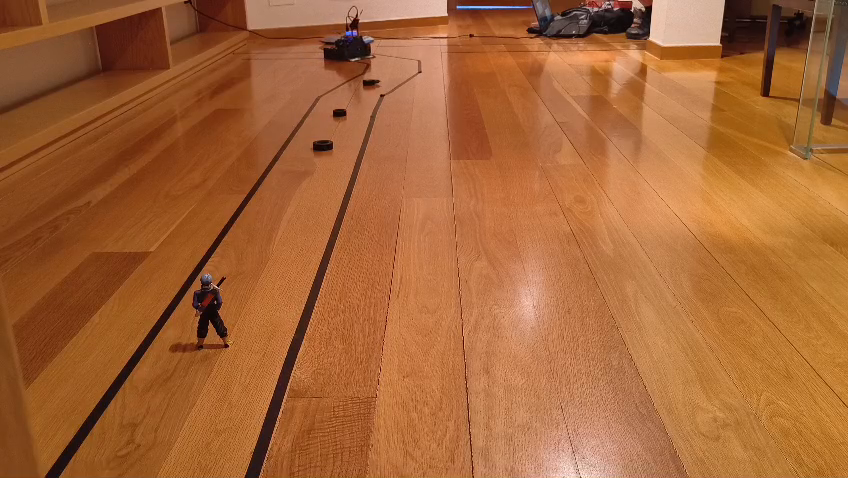

# Sumo Vision

**Robótica móvil · ESP32-CAM · Python · OpenCV · UDP**

[Demo](https://r2deeznuts.github.io/img/sumo-vision-preview.mp4) · [Guía de uso](GUIA.md) · [Memoria](Docs/memoria_final.pdf) · [Portfolio](https://r2deeznuts.github.io/)

Reutilicé un robot de sumo para un prototipo quitanieves que localiza y retira obstáculos dentro de un área delimitada. Integré las imágenes de una ESP32-CAM con OpenCV y la lógica que envía las órdenes de movimiento al robot mediante UDP.

El prototipo retiró obstáculos de forma autónoma. La [demostración](https://r2deeznuts.github.io/img/sumo-vision-preview.mp4) muestra su funcionamiento sobre la plataforma física.

[](https://r2deeznuts.github.io/img/sumo-vision-preview.mp4)

## Funcionamiento

La ESP32-CAM envía imágenes JPEG por UDP al ordenador. El programa Python
detecta las líneas y los obstáculos con OpenCV, decide el movimiento y envía
órdenes UDP al ESP32 que controla los motores. La interfaz permite ver el
procesamiento y alternar entre control automático y manual.

```text
ESP32-CAM ── vídeo UDP :5005 ──> Python / OpenCV ── órdenes UDP :9999 ──> Robot
```

## Puesta en marcha

Necesitas Python 3.12, una sesión gráfica para OpenCV, un robot con ESP32 y
una ESP32-CAM AI Thinker. Los tres dispositivos deben estar en la misma red.

```bash
git clone https://github.com/R2DeezNuts/sumo-vision.git
cd sumo-vision
python3 -m venv .venv
source .venv/bin/activate
python -m pip install -r requirements.txt
```

Configura y carga los dos firmwares siguiendo la [guía de uso](GUIA.md).
Ajusta la IP del robot en `blocks/3_enviar_respuesta/config.json` y ejecuta:

```bash
python main.py
```

El movimiento comienza bloqueado. `Enter` o espacio lo activa; `m` cambia
entre automático y manual; `q` o `Esc` cierra el programa y envía parada.
El automático envía parada si deja de recibir imágenes. Consulta las
limitaciones de control y red en la [guía](GUIA.md) antes de usar el robot.

## Estructura

| Ruta | Contenido |
| --- | --- |
| `main.py` | Aplicación y panel de diagnóstico |
| `blocks/` | Recepción, visión, decisiones y envío de órdenes; cada bloque tiene su `config.json` |
| `SUMO/` | Firmware del robot y herramientas de control y calibración |
| `SUMO_CAM/` | Firmware de la cámara y receptor de diagnóstico |
| `Docs/` | Memoria, presentación y documentación del código en PDF |
| `entrega/` | Fuentes LaTeX y Sphinx e instrucciones para regenerar los documentos |
| `tests/` | Pruebas sin placas ni ventana gráfica |

## Comprobaciones

```bash
python -m unittest discover -s tests -v
```

Estas pruebas no sustituyen la prueba del robot físico ni la calibración
de motores y visión.

## Documentación

- [Guía de instalación, red, firmware y controles](GUIA.md).
- [Memoria](Docs/memoria_final.pdf).
- [Presentación](Docs/Presentacion.pdf).
- [Documentación del código](Docs/documentacion_codigo.pdf).
- [Cómo regenerar la documentación](entrega/README.md).

[Volver al portfolio](https://r2deeznuts.github.io/)
